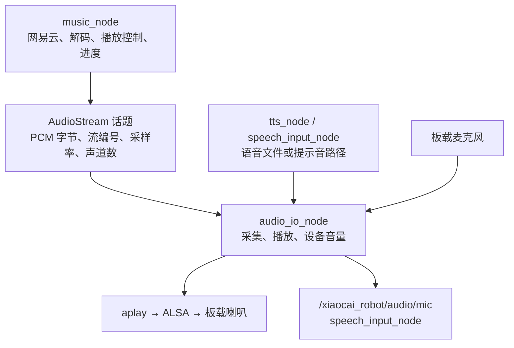
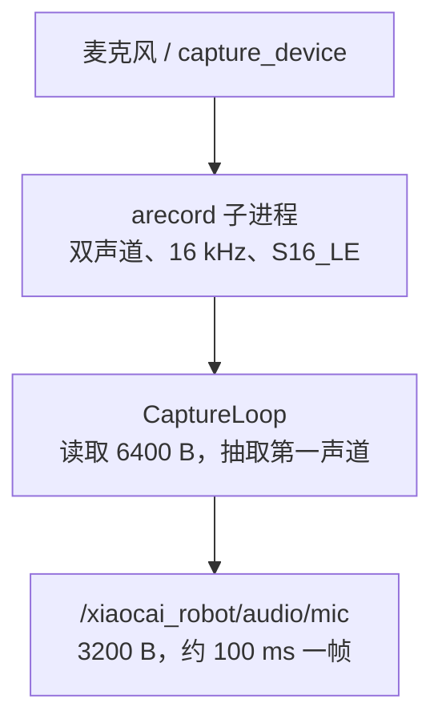
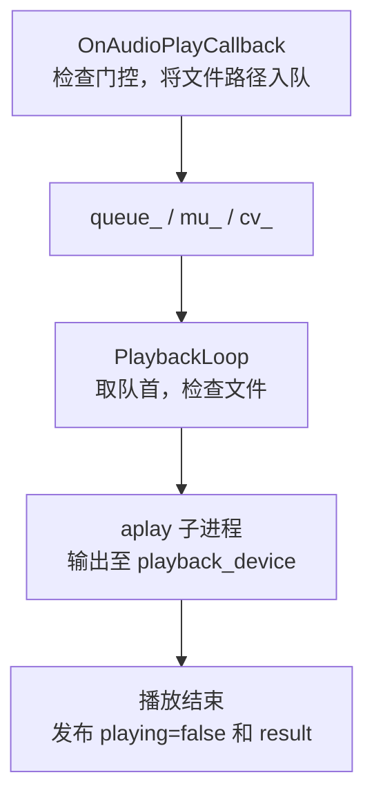
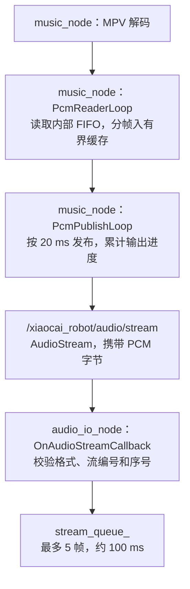
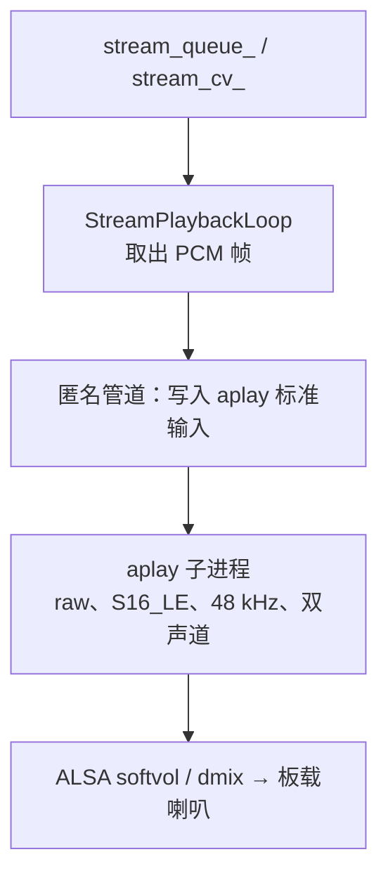
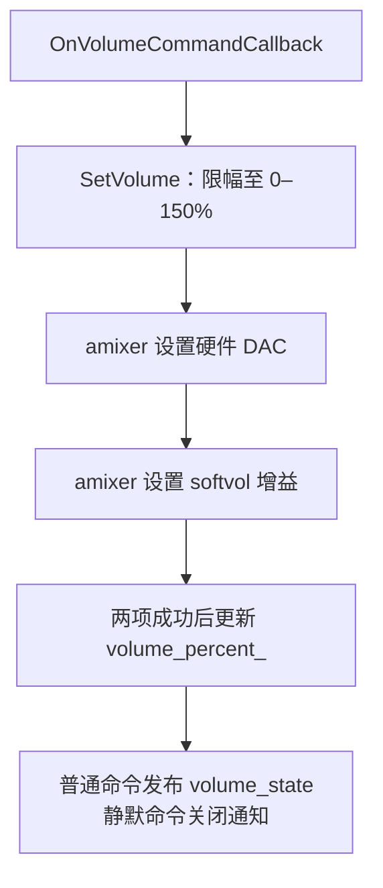

# audio_io 节点架构设计

## 1. 文档范围

本文对应 `audio_io_node` 当前源码，说明职责边界、线程、采集与输出数据流、ROS 接口和配置。所有话题使用 `/xiaocai_robot/<业务域>/<功能>` 三段式名称。

## 2. 节点职责与边界

`audio_io_node` 是板端的音频硬件适配层，负责麦克风采集、音频输出和设备音量。

| 组件 | 职责 |
| --- | --- |
| `audio_io_node` | 采集麦克风 PCM；播放语音、提示音文件和输入的 PCM 帧；设置、查询硬件输出音量；报告通用播放结果。 |
| `music_node` | 网易云登录、搜索、获取歌曲、解码、队列、上一首/下一首、暂停/继续、进度、歌词，以及语音结束后是否恢复音乐。 |
| `tts_node` | 将文本合成为语音文件，将路径交给音频节点。 |
| `speech_input_node` | 接收麦克风数据、识别语音和处理唤醒。 |

音乐经过 `music_node` 中的 ncm-cli/MPV 解码成 PCM，由音乐节点读取、分帧并通过 ROS 话题发送实际字节。MPV 使用 `ao=pcm`；音频节点的 `aplay` 打开声卡。音频节点收到通用的音频流编号、序号、格式、数据及结束/取消标志，不接收网易云 ID、歌单或音乐进度。

## 3. 总体结构

将数据流和线程分别画图。箭头统一表示数据传递或顺序执行，控制细节在图下说明。



### 3.1 执行位置与线程

主线程运行 `rclcpp::spin`，构造函数另创建 **三个工作线程**。其中两个负责原有的采集和文件播放，第三个消费持续输入的 PCM 帧，避免长时间音乐输出阻塞语音文件队列。

| 执行位置 | 入口 | 输入与等待 | 工作与输出 |
| --- | --- | --- | --- |
| ROS 主线程 | `rclcpp::spin` | 订阅、服务和 readiness 定时器 | 接收文件/流请求，更新队列和版本号，执行音量设置与查询。 |
| `capture_` 采集线程 | `CaptureLoop` | 阻塞读取 arecord 标准输出 | 每次读取 6400 B 双声道数据，抽取第一声道，发布 3200 B 单声道 PCM。 |
| `playback_` 文件播放线程 | `PlaybackLoop` | `mu_ + cv_ + queue_` | 按 FIFO 顺序播放语音、提示音和开机音乐，等待 aplay 结束并发布结果。 |
| `stream_playback_` PCM 输出线程 | `StreamPlaybackLoop` | `stream_mu_ + stream_cv_ + stream_revision_` | 等待 PCM 帧队列，启动 raw 模式 aplay，将采样字节写入其标准输入；处理流结束和取消。 |

`arecord` 和 `aplay` 是外部子进程；三个工作线程属于节点进程。音乐解码进程、PCM 读取与发送线程、状态定时器位于 `music_node`。音乐节点按已发布的 PCM 采样维护进度与运行状态；语音节点通过 awake 和 AudioPlay 通知音乐节点，不直接操作 MPV。

### 3.2 采集线程的数据流



管道、fork 或读取失败后，线程回收子进程，等待约一秒再尝试。接收方按单声道、16 kHz、S16_LE 解释数据。

### 3.3 文件播放线程的数据流



普通文件开始播放前发布 `playing=true`，等待约 80 ms，让订阅播放请求和状态的 `music_node` 协调暂停；结束后延迟约 250 ms 发布 `playing=false`。恢复音乐的决定由 `music_node` 做出。

开机音乐复用文件播放队列，只入队一次，允许在待机门控关闭时播放，并跳过 `playing` 通知。普通语音在收到配置的唤醒应答路径后解除门控；空路径关闭门控、清空文件队列并终止文件和 PCM 输出。

### 3.4 PCM 输出线程的数据流

先看节点之间的数据流：



再看音频节点内部的输出过程：



| 节点 / 线程 | 任务 |
| --- | --- |
| music_node / `pcm_reader_` | 尽快读取 MPV 的批量 PCM，分帧放入有界缓存；满时等待。 |
| music_node / `pcm_publisher_` | 每 20 ms 取一帧，通过 ROS 发布；暂停时等待，保留缓存。 |
| audio_io_node / `stream_playback_` | 从 ROS 接收队列取帧，写入 aplay；新流或取消会结束旧输出。 |

`OnAudioStreamCallback` 只校验和入队，不执行持续写入。每个数据帧都携带格式，因此音频节点重新启动后也可以从后续帧建立输出。新 `stream_id` 会清空旧队列、终止旧 aplay；同一流中的重复或过期序号被忽略。队列满时丢弃最旧帧并记录累计丢帧数，避免积累越来越长的播放延迟。

输出线程为当前流启动一个 aplay，使用非阻塞写入和 50 ms poll 等待，保证等待设备时仍可取消。匿名管道缓冲目标为 4096 B，aplay 请求 80 ms 缓冲和 20 ms 周期。`End` 表示排空已有数据后关闭输出，`Cancel` 表示立即丢弃队列并终止输出。aplay 失败通过 `AudioPlaybackResult` 返回 `pcm:<stream_id>`，音乐节点据此停止解码并发布音乐错误状态。

暂停和继续由 `music_node` 控制 PCM 发布；暂停会停止发帧、取消当前硬件输出并保留未发送的采样，继续时创建新输出流。MPV 只负责解码，预读缓存满后通过管道背压等待，不依赖 MPV 暂停命令。音频节点不计算音乐进度，也不调用 MPV 或 ncm-cli。

#### MPV、PCM 和内部管道

MPV 是播放器软件，负责把压缩音频解码成 PCM。PCM 表示按时间排列的采样值；当前使用 S16_LE（有符号 16 位、小端序）、48 kHz、双声道交错数据，每秒为 `48000 × 2 B × 2 = 192000 B`，20 ms 一帧为 3840 B。

音乐节点的 CLI 适配脚本给 MPV 设置：

```text
--ao=pcm
--ao-pcm-file=/tmp/xiaocai_music_node.pcm
--ao-pcm-waveheader=no
--gapless-audio=no
--audio-format=s16
--audio-samplerate=48000
--audio-channels=stereo
```

[MPV 官方手册](https://mpv.io/manual/stable/#audio-output-drivers) 说明了 PCM 文件输出和裸 PCM 选项。这里的 FIFO 只连接音乐节点内部的 MPV 子进程和 `PcmReaderLoop`，路径不会发给音频节点。

MPV 的 PCM 输出会批量写入，音乐节点的读取线程将数据放入有界缓存，发布线程按 20 ms 定时取帧。缓存最多 500 帧（约 10 秒）；开始播放前先缓存约 1 秒。播放中缓存耗尽时，音乐节点取消当前音频输出流，继续接收数据，积累约 5 秒后再建立输出流继续播放；如果音源已结束，则直接播放剩余数据。暂停时缓存保留，满后停止读取，背压阻塞解码器。若下载速度持续低于播放速度，仍可能多次等待缓冲。

暂停同时停止 ROS 数据发布，保留未发采样，继续时使用新流编号接着发送。音乐进度按已发布的 PCM 采样数累计，避免把解码预读位置误当成实际播放位置。`gapless-audio=no` 要求 MPV 在歌曲结束时关闭 PCM 写端，使读取线程收到 EOF。自然结束时先发送完缓存，再切换下一首。该缓存用于解码预读，不要求起播前先填满。

两个节点之间通过 ROS 传 PCM 字节；音频节点内部另用匿名管道连接自己的输出线程与 aplay。两处管道各自属于一个节点。

之前 MPV 使用 ALSA 输出时同样先解码成 PCM，再自己打开音频设备。现在把 PCM 交给音频节点集中输出。`Lyric` 指歌词；`MusicLyrics` 表示带时间信息的整首歌歌词，由音乐节点管理。

### 3.5 音量设置与查询



音量设置、查询均在 ROS 主线程执行。`GetVolume` 返回内存缓存中的百分比。文件和 PCM 流经过同一个 `playback_device`，共享输出音量。

## 4. 队列、取消和生命周期

- 文件队列使用 `mu_` 和 `cv_`；路径按先入先出顺序处理。
- PCM 流使用流编号、序号、有界队列与版本号；新流或取消会终止旧 aplay，正在等待写入的旧流在下一次 poll 后退出。
- `AudioPlay.path` 为空时，清理被取消的临时 TTS 文件，并为取消项发布失败结果；同时关闭 PCM 流。
- 采集、文件播放、PCM 输出子进程 PID 分别保存为原子变量。
- 析构时设置 `stop_`、递增流版本号、唤醒条件变量、向子进程发 SIGTERM，并 join 三个线程。
- 临时 TTS 路径前缀为 `/tmp/xiaocai_tts/`，播放完成、拒绝或取消后删除。

## 5. ROS 2 接口

### 5.1 订阅

| 话题 | 类型 | QoS | 行为 |
| --- | --- | --- | --- |
| `/xiaocai_robot/audio/play` | `AudioPlay` | depth 10 | 文件路径入队；空路径停止输出并清队列。 |
| `/xiaocai_robot/audio/stream` | `AudioStream` | depth 10，reliable、volatile | 接收 PCM 数据帧；新流替换当前流，End 排空，Cancel 立即停止。 |
| `/xiaocai_robot/audio/startup_music` | `std_msgs/Empty` | depth 10 | 请求播放一次配置的开机音乐。 |
| `/xiaocai_robot/audio/volume_command` | `VolumeCommand` | depth 10 | 设置、增加或减少音量，成功后发布状态。 |
| `/xiaocai_robot/audio/volume_silent_command` | `VolumeCommand` | depth 10 | 设置音量并更新缓存，关闭状态通知，供界面滑动使用。 |

`AudioStream` 统一使用交错的 S16_LE PCM。格式支持 8–192 kHz、1–2 声道；单帧上限为对应格式的 20 ms 数据量，必须包含完整的采样。音乐节点默认输出 48 kHz 双声道。

| 字段 | 含义 |
| --- | --- |
| `timestamp` | 帧发布时间。 |
| `action` | `AudioStreamAction`：Data=1、End=2、Cancel=3，枚举定义在 common。 |
| `stream_id` | 单调递增的非零音频流编号；切歌创建新编号。 |
| `sequence` | 流内递增序号，标识数据与控制帧。 |
| `sample_rate` / `channels` | PCM 采样率与声道数；每个数据帧都携带。 |
| `data` | PCM 字节数组；End、Cancel 不携带采样数据。 |

ROS QoS 深度为 10，节点自己的队列最多 5 帧。该机制面向板内实时音频；缓冲上限不等于端到端延迟保证，调度和设备缓冲仍会影响听感。

### 5.2 发布

| 话题 | 类型 | QoS | 含义 |
| --- | --- | --- | --- |
| `/xiaocai_robot/audio/mic` | `std_msgs/UInt8MultiArray` | depth 10 | 单声道 16 kHz、S16_LE 麦克风数据。 |
| `/xiaocai_robot/audio/playing` | `std_msgs/Bool` | depth 10 | 普通语音/提示音播放标志，供识别和音乐协调；不表示音乐播放状态。 |
| `/xiaocai_robot/audio/result` | `AudioPlaybackResult` | depth 100 | 通用文件或 PCM 流的播放结果；拒绝、取消或输出失败为 false。 |
| `/xiaocai_robot/audio/volume_state` | `std_msgs/Int32` | depth 1，transient local | 最近一次通知的音量百分比。静默命令不更新该保留通知。 |
| `/xiaocai_robot/system/readiness` | `NodeReadiness` | depth 1，transient local | 初始化完成后的就绪状态与周期更新。 |

音乐状态、进度及歌词分别由 `music_node` 发布到 `/xiaocai_robot/music/state` 和 `/xiaocai_robot/music/lyrics`。

### 5.3 服务

| 服务 | 类型 | 行为 |
| --- | --- | --- |
| `/xiaocai_robot/audio/get_volume` | `GetVolume` | 返回缓存音量；intent_node 可直接查询后播报，display_node 查询后更新滑块。 |

## 6. 配置与 ALSA 格式转换

参数统一由 `AudioIoConfig` 解析 `audio_io_node/config/biz_config.toml`。运行时从 `XIAOCAI_CONFIG_ROOT/audio_io_node/biz_config.toml` 读取，未设置时使用 ROS 包 share 目录。

| 配置项 | 默认值 | 用途 |
| --- | --- | --- |
| `capture_device` | `hw:0,0` | arecord 采集设备。 |
| `playback_device` | `xiaocai_speaker` | 文件和 PCM 流共同使用的 aplay 输出设备。 |
| `wake_ack_path` | 运行包 `resource/speech/wake_ack.wav` | 解除普通文件播放门控。 |
| `startup_music_path` | `audio/boot_music.wav` | 相对资源根目录的开机音频路径。 |
| `volume_percent` | 80 | 启动音量。 |
| `adc_pga_gain` / `mic_boost_gain` | 9 / 1 | 麦克风硬件增益。 |
| `alsa.pcm_name` | `xiaocai_speaker` | 生成的 softvol PCM 名称。 |
| `alsa.slave_pcm` | `plug:dmix` | softvol 的下层输出。 |
| `alsa.softvol_control_name` | `Xiaocai Output Gain` | 软件增益控件。 |
| `alsa.card` | 0 | 声卡编号。 |
| `alsa.min_db` / `alsa.max_db` | −60 / 6 | softvol 增益范围。 |
| `alsa.resolution` | 256 | 增益分辨率。 |

`biz_config.toml` 是配置源；`alsa_pcm.hpp` 是格式转换代码。后者接收已经解析的 `AlsaPcmSettings`，校验参数，生成进程私有的临时 `asound.conf`，设置 `ALSA_CONFIG_PATH`，供本节点及 arecord/aplay/amixer 子进程使用。ALSA 工具需要其原生配置格式，因此运行时转换仍然存在。仓库和运行包不再维护另一份固定 `asound.conf`。

音量设置先控制 RK809 DAC，再控制 softvol；仅全部成功才更新缓存。0% 对应 DAC=0，非零 DAC 限制在 252 以内；100% 以上通过 softvol 增益补偿，150% 最多约 +6 dB。`GetVolume` 返回缓存，不重新测量硬件。

## 7. 初始化与故障处理

1. 解析业务和日志配置，生成 ALSA 原生配置，声明支持覆盖的 ROS 参数。
2. 初始化发布、订阅、服务和 readiness 发布器。
3. 使用 amixer 选择 SPK 和 Main Mic 路径；播放静音 WAV 创建 softvol 控件。
4. 设置启动音量和麦克风增益，生成提示音 WAV。
5. 创建三个工作线程，调用 `MarkReady`。

就绪表示本地初始化流程和线程创建完成，不保证麦克风已采集到首帧。采集失败会重试；文件缺失、PCM 格式不支持、aplay 失败会记录日志，能够关联请求的播放失败同时发布 `AudioPlaybackResult`。音乐服务异常和网易云登录提示由 `music_node` 处理。

## 8. 源码定位

| 文件 | 职责 |
| --- | --- |
| `audio_io_node/src/main.cpp` | ROS 初始化及 spin。 |
| `audio_io_node/include/audio_io_node/audio_io_node.hpp` | ROS 接口、三个工作线程及同步成员声明。 |
| `audio_io_node/src/audio_io_node.cpp` | 回调协调、音量、采集、文件与 PCM 输出。 |
| `audio_io_node/include/audio_io_node/audio_io_config.hpp` | 已解析的配置结构与配置类。 |
| `audio_io_node/src/audio_io_config.cpp` | TOML 解析及资源路径解析。 |
| `audio_io_node/include/audio_io_node/alsa_pcm.hpp` | 将解析后的 ALSA 参数转换为工具需要的原生格式。 |
| `xiaocai_msgs/msg/AudioStream.msg` | 通用 ROS PCM 数据帧与流控制。 |
| `music_node/src/music_controller.cpp` | 网易云、队列、播放控制、进度和后台订阅。 |
| `music_node/config/ncm_player_compat.cjs` | CLI 0.1.7 超时适配与 PCM 解码输出设置，仅加载到音乐控制器启动的 CLI 中。 |

## 9. 板端验证记录（2026-10-26）

已在泰山板实际运行验证：

| 项目 | 结果 |
| --- | --- |
| ROS PCM 连续输出 | 独立播放复核：12 秒接收 601 帧、2,307,840 B；最大帧间隔约 31 ms；48 kHz、双声道、S16_LE、序号递增、数据非零。 |
| 音乐控制 | 指定歌曲、上一首、下一首、自然结束自动切歌通过；下一首会选择其他歌曲。 |
| 随机点歌 | “任意一首音乐”等通用请求使用配置的默认搜索词，实际播放通过。 |
| 暂停与继续 | 暂停 25 秒进度保持，继续后同一首歌持续播放通过。 |
| 停止与取消 | 停止、闭嘴取消搜索、取消后阻止自动恢复通过。 |
| 输出设备归属 | MPV 不持有播放声卡；实际输出设备由 audio_io_node 启动的 aplay 持有。 |
| 话题与音量 | 28 个运行中的项目话题均为三段式；普通/静默音量命令、查询、状态订阅通过；测试后恢复至 80%。 |

连续输出数据是在取流完成后、没有切歌或调音量操作的独立窗口测得。首次网络取流和测试中的网络跳转曾出现等待，以上结果不表示弱网或任意启动阶段都没有缓冲。

板端重启后曾观察到系统时间回退，本轮联网验证前已校准当前时间；本次未修改系统开机授时策略。
