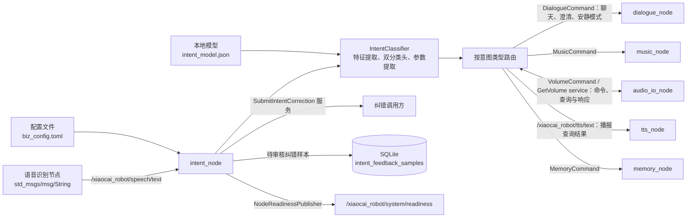

# intent_node 架构设计

## 1. 文档范围

本文描述 `intent_node` 当前代码实现的运行时架构、ROS 2 接口、意图分类与路由、纠错样本存储，以及离线模型训练流程。内容以 `src/`、`include/`、`config/`、`training/` 和 `assets/intent_model.json` 为依据；不把 `RESEARCH.md` 中已经淘汰的 RoBERTa 方案当作当前实现。

## 2. 节点职责

`intent_node` 接收语音识别产生的文本，对每条非空文本独立进行意图分类和参数提取，然后将结果转换为面向下游节点的 ROS 消息。它还负责检测用户是否在纠正上一条表达，并保存纠错样本。

节点本身不执行音乐播放、音量调整或记忆读写；这些动作由对应下游节点完成。音量查询由本节点直接调用音频节点的 `GetVolume` 服务，收到当前音量后通过 TTS 文本话题播报；服务不可用或超时会播报暂不可用。除短期纠错检测所需的上一条文本和分类结果外，当前实现不维护多轮对话槽位或长期会话上下文。

## 3. 总体架构



只有聊天、提醒澄清和免打扰切换等需要对话能力的意图才会发布 `/xiaocai_robot/dialogue/command`。音量查询不经过 `dialogue_node`：`intent_node` 直接调用 `audio_io_node` 提供的 `/xiaocai_robot/audio/get_volume` 服务，收到当前值后通过 `/xiaocai_robot/tts/text` 播报。音乐、音量调节、记忆等业务命令也只发往各自业务节点。

处理主路径如下：

1. 从 `/xiaocai_robot/speech/text` 收到文本。
2. `IntentClassifier` 去除 Unicode 空白，计算字符 n-gram 特征，并分别预测意图类别和纠错类别。
3. 根据分类结果提取音乐查询、音量数值、记忆内容或提醒时长等参数。
4. `IntentNode` 将结果路由到 `DialogueCommand`、`MusicCommand`、`VolumeCommand` 或 `MemoryCommand`；音量查询由本节点直接调用 `audio_io_node` 的服务，不发布 `DialogueCommand`。
5. 若纠错检测成立且反馈存储已初始化，则把本轮文本与上一轮预测信息记入 SQLite，状态为 `pending`。

## 4. ROS 2 接口

### 4.1 订阅

| 名称 | 类型 | 用途 |
| --- | --- | --- |
| `/xiaocai_robot/speech/text` | `std_msgs/msg/String` | 接收上游语音识别文本。 |

空字符串或规范化后只剩空白的输入会被忽略，不会发布分类结果。

### 4.2 发布

| 名称 | 类型 | 下游用途 |
| --- | --- | --- |
| `/xiaocai_robot/dialogue/command` | `xiaocai_msgs/msg/DialogueCommand` | 普通聊天、安静模式切换、提醒澄清等需要对话节点处理的意图。音量查询不发到此话题。 |
| `/xiaocai_robot/music/command` | `xiaocai_msgs/msg/MusicCommand` | 播放、暂停、继续、停止、下一首、上一首，并携带查询文本。 |
| `/xiaocai_robot/audio/volume_command` | `xiaocai_msgs/msg/VolumeCommand` | 设置、增加或减少音量。 |
| `/xiaocai_robot/tts/text` | `std_msgs/msg/String` | 由 `intent_node` 播报音量查询结果；语音合成仍由 `tts_node` 执行。 |
| `/xiaocai_robot/memory/command` | `xiaocai_msgs/msg/MemoryCommand` | 事实保存、删除、列举和提醒创建等操作。 |
| `/xiaocai_robot/system/readiness` | `xiaocai_msgs/msg/NodeReadiness` | 由公共 `NodeReadinessPublisher` 周期发布节点就绪状态；节点完成初始化后标记为 ready。 |

消息中的意图、音乐动作、音量动作和记忆操作编号由 `xiaocai_msgs` 的公共枚举定义，新增或调整编号时需同步检查消息包和消费者。

### 4.3 服务调用

| 名称 | 类型 | 用途 |
| --- | --- | --- |
| `/xiaocai_robot/audio/get_volume` | `xiaocai_msgs/srv/GetVolume` | 音量查询意图由 `intent_node` 直接调用此服务；请求音频节点读取其当前音量，不经过 `dialogue_node`。 |

### 4.4 服务

| 名称 | 类型 | 用途 |
| --- | --- | --- |
| `/xiaocai_robot/intent/feedback` | `xiaocai_msgs/srv/SubmitIntentCorrection` | 接收显式纠错样本，字段包含时间戳、原文本、纠正文本、预测标签、正确标签和预测分数；响应包含是否接受、样本 ID 和错误信息。 |

服务写入前会检查反馈功能是否启用、存储是否就绪，以及时间戳、文本、标签和分数是否合法。服务提交和自动检测到的纠错均只保存为待处理样本，不会在线修改模型。

## 5. 分类与路由

### 5.1 当前分类器

模型文件采用 `hashed_character_ngram_softmax` 算法，包含意图分类头和二分类纠错头。当前模型元数据为 8192 维特征、最大 n-gram 长度 3，标签包含 `chat`、六种音乐操作、音量查询/设置/增减、安静模式开关、记忆列举/保存/删除和提醒创建/澄清。

分类器对 UTF-8 文本解码，移除 Unicode 空白；按字符生成 1 至 3 元 n-gram，并加入文本起止边界标记。每个 n-gram 通过 FNV-1a 哈希映射到固定维度，计数后做 L2 归一化。线性权重与偏置产生 logits，再经过 softmax 得到类别概率。

两个分类头的决策规则如下：

- 意图分类头取概率最高的标签。最高分低于 `confidence_threshold` 时，回退到 `chat`。
- 纠错头输出 `normal` 或 `correction` 的概率。只有意图分数达到置信度阈值且纠错概率达到 `correction_threshold`，本轮才标记为纠错。
- 模型版本、算法名、标签矩阵和参数维度会在加载时校验。模型缺失或格式不合法会导致构造失败，节点无法完成启动就绪流程。

当前配置文件中的阈值为 `confidence_threshold = 0.25`、`correction_threshold = 0.65`。代码仅接受 `[0, 1]` 范围内的阈值覆盖值。

### 5.2 意图映射

| 模型标签 | 下游消息及动作 |
| --- | --- |
| `chat` | `DialogueCommand`，交由对话节点处理。 |
| `music_play`、`music_pause`、`music_resume`、`music_stop`、`music_next`、`music_previous` | `MusicCommand`，动作对应播放、暂停、继续、停止、下一首、上一首；播放类文本会提取查询词。 |
| `volume_get` | `intent_node` 直接调用 `audio_io_node` 的 `/xiaocai_robot/audio/get_volume` 服务，再通过 `/xiaocai_robot/tts/text` 播报当前值；不经过 `dialogue_node`。 |
| `quiet_on`、`quiet_off` | `DialogueCommand`，由对话节点更新免打扰状态并回复。 |
| `volume_set`、`volume_up`、`volume_down` | `VolumeCommand`，设置音量时提取百分比；缺少有效数值时回退到聊天意图。设置值被限制在 0 至 150。 |
| `memory_list`、`memory_save`、`memory_forget` | `MemoryCommand`，分别列举、保存和删除记忆；保存/删除缺少有效内容时回退到聊天意图。 |
| `reminder_create` | `MemoryCommand` 的提醒创建操作，提取提醒内容和相对时长。当前支持秒、分钟、小时、天，时长必须为正且不超过 30 天。 |
| `reminder_clarify` | `DialogueCommand`，让对话节点请求补充提醒信息。 |

参数提取属于分类后的确定性处理，不替代意图分类。音乐查询、数字、记忆内容或提醒时长无法可靠提取时，代码会按对应路径留空、回退为聊天意图或转为提醒澄清。

### 5.3 纠错上下文

节点只保留最近一条输入文本、预测标签、预测分数和单调时钟时间。当前输入被判定为纠错、与上一标签不同且上一条输入仍在 60 秒窗口内时，节点尝试将上一条文本和当前纠正文本保存为纠错样本。随后当前输入会成为新的“上一条”上下文。

该逻辑用于收集后续离线训练材料，不会重新解释上一轮消息，也不提供完整的多轮语义状态管理。

## 6. 反馈存储与离线训练

`IntentFeedbackStore` 使用 SQLite，数据库表为 `intent_feedback_samples`，保存时间戳、原文本、纠正文本、预测标签、正确标签、预测分数和状态。新样本的状态为 `pending`，并按状态和时间建立索引。数据库连接使用 `READWRITE | CREATE | FULLMUTEX`，并设置 3 秒 busy timeout。

当前节点实现写入和初始化能力，没有样本查询、审核状态更新或直接重训接口。反馈库不会被运行时分类器读取。

### 6.1 训练数据

训练数据由 `training/data/intent_examples.jsonl` 和 `training/data/intent_correction_examples.jsonl` 两个 JSONL 文件组成。每行至少包含 `text`、`label`、`split`；纠错数据还包含布尔值 `is_correction`。`split` 必须是 `train`、`validation` 或 `test`，`label` 必须在 `training/intent_labels.json` 中定义。当前标签映射还决定分类结果最终对应的 C++ 路由。

训练脚本会拒绝空文本、未知标签、非法 split、缺失任一标签的数据切分，以及规范化（移除空白）后跨切分重复的文本。普通意图样本和纠错表达都会训练意图分类头；纠错头则根据 `is_correction` 学习 `normal` / `correction`。新增或审核 SQLite 中的待处理样本后，需要人工整理并分配 split，再加入 JSONL；数据库不会自动进入训练。

当前数据共 516 条，按 `train`、`validation`、`test` 分别为 372、72、72 条。每个 split 都覆盖 18 个意图标签。

### 6.2 模型训练方法

`train_intent_classifier.py` 只依赖 Python 标准库。其训练过程为：

1. 去除输入中的空白，为文本添加起止边界标记，并生成 1 至 3 字符 n-gram。
2. 使用 FNV-1a 将 n-gram 哈希到 8192 维向量，按 L2 范数归一化。
3. 分别训练 18 类意图 softmax 分类器和 2 类纠错 softmax 分类器。训练采用逐样本随机梯度下降，固定 120 轮；默认随机种子为 42（纠错头使用 43），初始学习率 0.18 并随训练步数衰减，L2 系数为 0.0001。纠错头通过类别权重平衡正负例。
4. 将模型元数据、标签、阈值和权重矩阵写入 JSON。意图权重矩阵为 18 × 8193，纠错权重矩阵为 2 × 8193；每行最后一列是偏置项。

### 6.3 可复现训练步骤

在仓库根目录执行。先将候选模型写到临时路径，避免评估前覆盖当前运行模型：

```bash
python3 intent_node/training/train_intent_classifier.py \
  --output /tmp/intent_model_candidate.json
```

训练脚本会检查数据，并在结束时打印 validation 和 test 上的意图准确率、Macro-F1、纠错检测 Precision/Recall/F1。再对候选模型单独查看混淆矩阵和样例预测：

```bash
python3 intent_node/training/evaluate_intent_classifier.py \
  --model /tmp/intent_model_candidate.json --split validation
python3 intent_node/training/evaluate_intent_classifier.py \
  --model /tmp/intent_model_candidate.json --split test
python3 intent_node/training/predict_intent.py \
  --model /tmp/intent_model_candidate.json \
  --text "不是播放音乐，是暂停"
```

评估脚本会输出意图混淆矩阵及纠错检测指标；单句预测会显示意图标签、意图置信度和纠错置信度。确认指标和代表性表达符合预期后，将候选模型替换为运行时资源并重新打包：

```bash
cp /tmp/intent_model_candidate.json intent_node/assets/intent_model.json
make build && make ota
```

默认情况下不传 `--output` 会直接覆盖 `intent_node/assets/intent_model.json`。训练脚本也支持通过 `--data`、`--correction-data`、`--labels` 和 `--seed` 指定输入文件及随机种子。打包脚本会将该模型放入板端资源路径 `resource/intent/intent_model.json`。

当前训练集是人工整理的小规模数据。`RESEARCH.md` 记录的本轮结果为验证集意图准确率/Macro-F1 `0.819/0.818`、测试集 `0.806/0.800`；纠错检测测试集精确率/召回率为 `1.0/0.833`。这些结果只代表当前切分数据，不能视作真实 ASR 输入或板端部署效果保证；文档中尚无板端延迟、内存占用、CPU 占用和端到端识别评测数据。

## 7. 配置、资源与启动

配置文件 `config/biz_config.toml` 的关键项：

| 配置项 | 当前值 | 含义 |
| --- | --- | --- |
| `classifier.model_path` | `intent/intent_model.json` | 模型资源路径。 |
| `classifier.confidence_threshold` | `0.25` | 意图最低置信度；低于阈值回退为 `chat`。 |
| `classifier.correction_threshold` | `0.65` | 纠错概率阈值。 |
| `intent_feedback.enabled` | `true` | 是否初始化并允许使用纠错存储。 |
| `intent_feedback.db_path` | `/userdata/config/intent_node/intent_feedback.sqlite3` | SQLite 文件路径。 |

公共配置基类优先读取 `$XIAOCAI_CONFIG_ROOT/intent_node/biz_config.toml`，未设置时回退到 ament 包 share 目录下的 `config/biz_config.toml`。相对模型路径会在设置 `$XIAOCAI_RESOURCE_ROOT` 时相对于该目录解析；绝对路径直接使用。板端启动脚本会设置这两个环境变量。

`main.cpp` 初始化 rclcpp、创建单个 `IntentNode` 并进入 `rclcpp::spin`。构造阶段依次加载配置和日志、加载模型、初始化反馈存储、创建 ROS 发布者/订阅者/服务，最后发布 ready 状态。SQLite 初始化失败会记录错误，节点仍可提供意图分类，但纠错样本不可写入；模型加载失败则会阻止节点构造和就绪。

构建使用 C++17、`rclcpp`、`std_msgs`、`xiaocai_msgs`，并链接 SQLite 和线程库。JSON、TOML 解析依赖源码树中的 vendored 头文件；板端推理不依赖 PyTorch、Transformers 或 ONNX Runtime。Python 训练/评估脚本使用标准库。

## 8. 代码模块

| 文件 | 职责 |
| --- | --- |
| `src/main.cpp` | ROS 2 进程入口和单节点 spin。 |
| `src/intent_node.cpp`、`include/intent_node/intent_node.hpp` | ROS 接口、输入回调、纠错上下文、结果路由及 ready 状态。 |
| `src/intent_classifier.cpp`、`include/intent_node/intent_classifier.hpp` | 模型加载校验、特征计算、两类预测、意图路由映射和参数提取。 |
| `src/intent_config.cpp`、`include/intent_node/intent_config.hpp` | 分类阈值、模型路径和反馈存储配置。 |
| `src/intent_feedback_store.cpp`、`include/intent_node/intent_feedback_store.hpp` | SQLite 初始化与纠错样本持久化。 |
| `training/` | 数据集、标签映射、训练、评估和本地预测工具。 |
| `assets/intent_model.json` | 当前运行时加载的模型参数及元数据。 |

## 9. 当前边界与后续关注点

- 意图模型及数据集是小规模、人工整理版本，持续补充真实 ASR 口语、噪声和近义表达样本有助于减少混淆。
- 纠错样本目前只落库，没有在节点内审核、导出或触发重训的流程；需要通过离线流程管理样本和模型版本。
- `chat` 是低置信度时的默认回退，因此其下游表现会同时受到真实聊天分类与分类不确定性的影响。
- 提醒参数当前按相对时间解析，不是完整日期时间解析；此能力边界应在扩展提醒语法时同步更新数据和评估。
- 当前研究记录未覆盖板端资源和端到端 ASR 实测，模型轻量不等同于已经验证实时性。

## 10. 主要实现位置

- 节点与分类器：[`src/intent_node.cpp`](../src/intent_node.cpp)、[`src/intent_classifier.cpp`](../src/intent_classifier.cpp)
- 配置：[`config/biz_config.toml`](../config/biz_config.toml)
- 训练说明：[`training/README.md`](../training/README.md)
- 当前研究记录与评估结果：[`RESEARCH.md`](../RESEARCH.md)
- ROS 消息定义：[`../xiaocai_msgs/msg`](../../xiaocai_msgs/msg)
